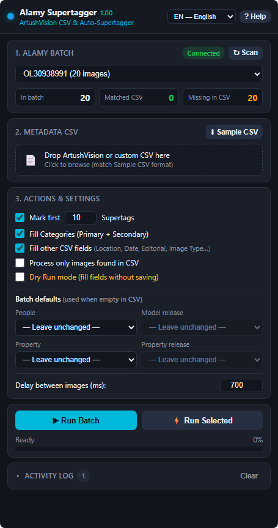

# Alamy Supertagger & CSV Autofill: Automate Your Stock Workflow

[← Back to ArtushVision AI Home](https://vision.artushfoto.eu)

**Save hours of repetitive manual clicking in Alamy Image Manager. Automatically mark your top 10 Supertags and populate titles, descriptions, keywords, and categories from ArtushVision AI or any custom CSV template.**

Submitting content to **Alamy** often requires tedious manual steps inside the **Alamy Image Manager**—especially selecting the **first 10 Supertags** for every single image and manually mapping categories or metadata fields. 

The [**Alamy Supertagger & CSV Autofill**](https://chromewebstore.google.com/detail/alamy-supertagger-csv-aut/jfdfhcpmfeamolnbibjdoehepbopihlm) browser extension bridges this gap. While tailored for seamless integration with **ArtushVision AI** exports, it is built as a **100% universal tool** that works with any CSV spreadsheet formatted to a simple standard template.

---

## 1. Key Features & Universal CSV Support

Whether you generate metadata in ArtushVision AI, Excel, Google Sheets, or any other AI keywording software, this extension automates the final mile of your Alamy submission.

- **1-Click Top 10 Supertags:** Automatically selects and marks the first 10 keywords in your list as **Supertags**—eliminating hundreds of repetitive clicks per batch and boosting your commercial search visibility on Alamy.
- **Universal CSV Compatibility:** Works out-of-the-box with **ArtushVision AI CSV exports**, as well as **any custom CSV file** structured according to the standard template.
- **Complete Metadata & Category Autofill:** Reads your CSV file and automatically populates Titles, Descriptions, Keywords, and Alamy Categories directly into the web interface.
- **100% Local & Privacy-First:** All CSV parsing and DOM automation happen locally inside your browser. Your data and files are never uploaded to any external servers.

---

## 2. Installation & Getting Started

Install the extension directly from the [**Chrome Web Store** ](https://chromewebstore.google.com/detail/alamy-supertagger-csv-aut/jfdfhcpmfeamolnbibjdoehepbopihlm)(compatible with Google Chrome, Microsoft Edge, Brave, and other Chromium-based browsers).

1. Visit the [**Chrome Web Store** ](https://chromewebstore.google.com/detail/alamy-supertagger-csv-aut/jfdfhcpmfeamolnbibjdoehepbopihlm)and click **Add to Chrome** on the *Alamy Supertagger & CSV Autofill* page.
2. Pin the extension icon to your browser toolbar for quick access.
3. Log in to your **Alamy Contributor Portal** and open **Alamy Image Manager**.

---

## 3. Using Universal CSV Templates

You do not need to be an ArtushVision AI user to benefit from automated CSV filling. Any spreadsheet exported as a UTF-8 CSV matching the template columns can be loaded into the extension.

### Standard CSV Structure
Ensure your CSV file contains the following header columns (case-insensitive matching supported):

| Column Name | Description | Example |
| :--- | :--- | :--- |
| **`Filename`** | Exact filename of the uploaded image on Alamy (with or without extension). | `IMG_4821.jpg` |
| **`Title`** | Main commercial title / caption for the image. | `Aerial view of autumn forest in misty mountains` |
| **`Description`** | Detailed editorial or commercial description (optional). | `Morning fog rolling over colorful autumn trees at sunrise.` |
| **`Keywords`** | Comma-separated list of keywords. **The first 10 tags will be marked as Supertags.** | `autumn, forest, fog, mountains, aerial, nature, trees, mist, sunrise, landscape` |
| **`Category`** | Primary Alamy category name (optional). | `Landscapes` |

> **Pro Tip for Supertags:** Alamy prioritizes the first 10 keywords marked as **Supertags**. Always place your 10 strongest, most descriptive keywords at the very beginning of your `Keywords` column!

---

## 4. Extension Interface & Controls

When you click the **Alamy Supertagger & CSV Autofill** icon while inside Alamy Image Manager, a clean control popup gives you full control over your batch:

- **Load CSV File:** Select your exported `.csv` file from ArtushVision AI or your custom spreadsheet. The extension immediately indexes all rows by filename.
- **Auto-Mark Top 10 Supertags:** Automatically checks the Supertag boxes for the first 10 keywords on the active image(s).
- **Autofill Metadata & Categories:** Matches the currently selected image in Alamy Image Manager with its corresponding row in your CSV and fills in all text fields and category dropdowns.
- **Batch Processing / Next Image:** Move smoothly through your uploaded batch without losing your loaded CSV state.

<video src="video/alamy-supertagger-workflow.mp4" width="100%" autoplay loop muted playsinline title="Alamy Supertagger & CSV Autofill - Full Workflow Demo">
  Alamy Supertagger & CSV Autofill - Full Workflow Demo.
</video>

<a href="video/alamy-supertagger-workflow.mp4" target="_blank" style="font-size: 0.9em;">Watch tutorial: Alamy Supertagger & CSV Autofill Workflow (full size)</a>

---

## 5. Recommended Alamy Submission Workflow

Prepare Metadata (ArtushVision AI or Custom CSV) ➔ Upload Images to Alamy Image Manager ➔ Load CSV in Extension ➔ Autofill & Supertag ➔ Review & Submit.

1. **Generate or Prepare Metadata:** Export your metadata CSV directly from **ArtushVision AI**, or prepare your own spreadsheet using the standard CSV template. Make sure your top 10 keywords are listed first.
2. **Upload Media to Alamy:** Upload your JPEGs or vectors to **Alamy Image Manager** as usual.
3. **Open the Extension:** Once your images appear in the manager grid or editor view, click the [**Alamy Supertagger**](https://chromewebstore.google.com/detail/alamy-supertagger-csv-aut/jfdfhcpmfeamolnbibjdoehepbopihlm) icon in your browser toolbar.
4. **Load Your CSV:** Import your `.csv` file into the extension.
5. [**Run Autofill & Supertagger:**](https://chromewebstore.google.com/detail/alamy-supertagger-csv-aut/jfdfhcpmfeamolnbibjdoehepbopihlm) Trigger the autofill and watch the extension populate your titles, descriptions, categories, keywords, and top 10 Supertags in seconds.
6. **Final Check & Submit:** Quickly verify the populated fields in Alamy Image Manager and submit your batch for QC!

---

### [Get Started Now]
- [Install Alamy Supertagger & CSV Autofill (Chrome Web Store)](#)
- [Download ArtushVision AI Free Lite Version](/docs/download-purchase.html)
- [Purchase ArtushVision AI Lifetime License - $39.99](/docs/download-purchase.html#buy-lifetime-license)

---

## Need Help?

Search the documentation pages directly or jump back to the main [Complete Documentation Index](/index.html#complete-documentation-index).

---

[← Back to ArtushVision AI Home](https://vision.artushfoto.eu)

[⭐ User Reviews & Testimonials](/docs/artushvision-reviews.html)

[❓ Frequently Asked Questions (FAQ)](/docs/faq.html)

[💬 Support, Bugs & Community Forum](https://github.com/Artushfoto/ArtushVision-AI/discussions)

---

*ArtushVision AI - Stability and precision for professional photography workflows.*

<!-- Odložené načtení Google Analytics pro maximální PageSpeed skóre -->
