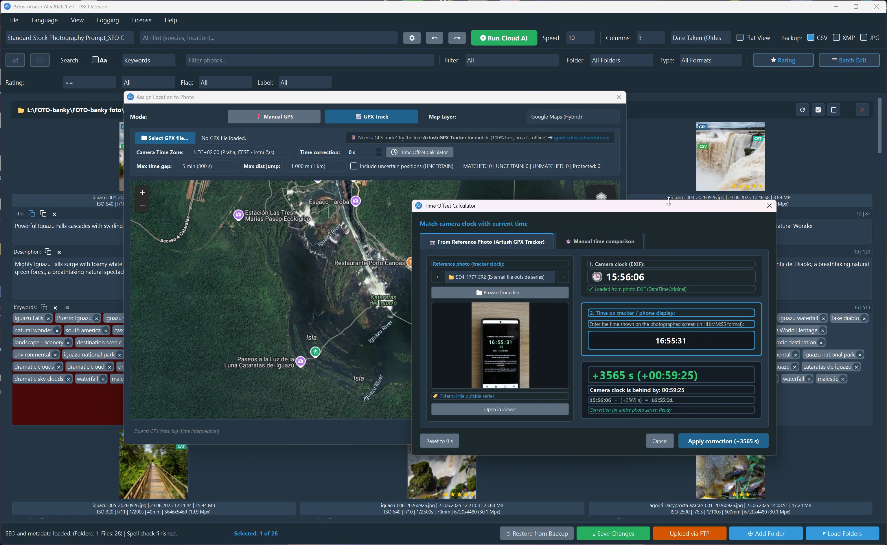
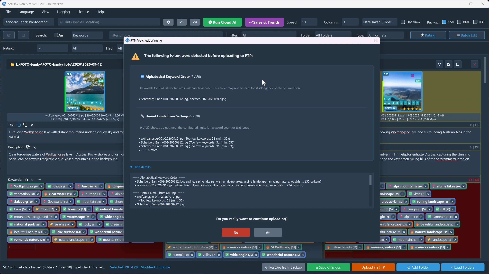
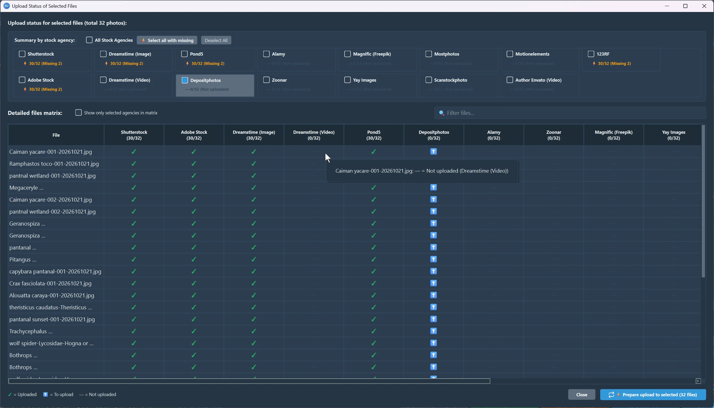

# What's New in ArtushVision AI v1.20

[← Back to ArtushVision AI Home](https://vision.artushfoto.eu)

  <strong>🎉 Free Update for v1.x Users:</strong> Version 1.20 is a free update for all active lifetime license owners. Existing users can update directly via <strong>Help → Check for Updates</strong> inside the application.

Version 1.20 introduces a major milestone for ArtushVision AI: **Microstock Market Intelligence, Selling Score analytics, and lossless MP4/MOV video metadata injection for professional stock contributors.**

ArtushVision AI now brings together computer vision, commercial market intelligence, buyer-oriented search language, biological taxonomy, and geographic validation in a seamless, high-speed metadata workstation.

---

## Version 1.20 Changelog Summary

* **New:** Microstock Market Intelligence suite.
  * Dynamic Commercial Selling Score (0–100%).
  * Bestseller GAP analysis for commercially relevant metadata opportunities.
  * Commercial multi-word buyer phrase detection.
  * Keyword autocomplete powered by real buyer search queries and synonyms
  * Market Discovery for niche, conceptual, and emerging search opportunities.
  * SEO Sort algorithm with `Ctrl+Shift+S` shortcut.
  * Explainable Keyword Verdicts (🔥 MUST USE, ✅ RECOMMENDED, ⚠️ OPTIONAL, ❌ AVOID).
  * Smart SEO Expand with dedicated suggestion tray.
* **New:** Native MP4 / MOV lossless metadata writing without re-encoding similar to JPG.
* **New:** Scientific binomial (Latin) taxonomy validation.
* **New:** GPS-assisted geographic validation.
* **New:** Human-presence evidence validation.
* **New:** Multi-template batch CSV export.
* **New:** Universal Drag & Drop supporting mixed RAW/JPG/MP4/MOV folders.
* **New:** Native WebP format support (lossless metadata read/write, thumbnails, GPS).
* **New:** Smart FTP Pre-Check with Alphabetical Keywords (A–Z) detection & limits validation.
* **New:** FTP Upload Tracking: Tracks uploaded files per agency, shows missing destinations based on your FTP settings, and lets you select additional targets for subsequent upload.
* **New:** Complete IPTC & XMP location hierarchy mapping (`City`, `State`, `CountryCode`, `Sublocation`) for 100% Adobe Lightroom Classic compatibility.
* **New:** GPS fields (`Latitude`, `Longitude`, `Altitude`, `Source`) in CSV templates & backups.
* **New:** Camera Time Drift Calculator with Reference Photo support & Artush GPX Tracker ecosystem.
* **New:** GPS Removal & Privacy Anonymization tool with hardware EXIF protection.
* **New:** Privacy-first Diagnostic Support Reporter with GDPR-compliant log packaging.
* **New:** 100% synchronized localization across all 19 supported languages (1829+ keys).

---

## [Microstock Market Intelligence](microstock-seo-sales-engine.html)

ArtushVision AI now goes far beyond generating visually descriptive tags.

**Microstock Market Intelligence** adds commercial context to your cataloging workflow, helping contributors identify relevant market opportunities, missing keywords, and buyer-oriented search patterns.

It provides actionable insight into:

* Commercial keyword demand and market context,
* Buyer-oriented search phrases,
* Commercially relevant keywords missing from your current metadata,
* Dynamic metadata strength analysis before agency submission,
* Emerging and niche market opportunities.

Market Intelligence is designed to provide **evidence-based commercial context**, helping contributors make better-informed metadata decisions while retaining full control over the final result.

---

### [Commercial Selling Score](microstock-seo-sales-engine.html#-commercial-selling-score--quick-wins)

Evaluate the commercial strength of your metadata before submitting to agencies.

ArtushVision AI calculates a dynamic **Selling Score (0–100%)** based on the overall quality, relevance, structure, and commercial strength of your metadata.

The analysis considers areas such as:

* **Title & Description Quality:** Clear structure and effective presentation of the asset.
* **Commercial Relevance:** Coverage of meaningful buyer-oriented concepts.
* **Metadata Structure:** Overall keyword organization and metadata completeness.
* **Consistency & Relevance:** Detection of unnecessary, conflicting, or weak metadata.

The Selling Score provides a **consistent benchmark for evaluating metadata strength** before submission.

It is a metadata analysis tool — **not a prediction of sales, revenue, or search position**.

---

### [Bestseller Keyword GAP Analysis — Find Missing Keywords & Discover New Commercial Phrases](microstock-seo-sales-engine.html#-bestseller-keyword-gap-analysis--find-missing-keywords--discover-new-commercial-phrases)

**Bestseller GAP** identifies commercially relevant metadata opportunities that may be missing from your current file.

Instead of guessing what buyers may be searching for:

* Inspect relevant missing terms alongside your current metadata,
* Review their available commercial context,
* Identify potential metadata gaps,
* Add selected terms with a single click without overriding your creative judgment.

Bestseller GAP is designed to expose **useful market opportunities while leaving the final metadata decision to the contributor**.

---

### [Commercial Buyer Phrases](microstock-seo-sales-engine.html#the-evolution-of-microstock-keywording-from-metadata-to-market-intelligence)

Stock buyers frequently search using multi-word concepts rather than isolated keywords.

The **Commercial Phrases** engine automatically identifies and prioritizes commercially relevant phrases such as:

* `baking ourselves`
* `misty scene`
* `aerial view`
* `candid lifestyle`
* `wild animal`

Suggested phrases are checked against available visual and contextual evidence to help reduce unsupported or irrelevant metadata.

---

### [Market Discovery - Smart SEO Keyword Expander](microstock-seo-sales-engine.html#-smart-seo-keyword-expander)

**Market Discovery** acts as an intelligent keyword scout, cross-referencing your image subject with real-world buyer search trends.

It surfaces:

* **High-Value Niches:** Commercially viable search targets identified from microstock demand.
* **Conceptual Terms:** Metaphorical and buyer-oriented themes (such as *resilience*, *teamwork*, or *tranquility*) that aren't strictly visible physical objects.
* **Seasonal & Rising Queries:** Timely search trends aligned with current commercial interest.

**Smart SEO Expand** then delivers a curated, non-destructive extension of your metadata.

Instead of flooding your list with generic synonyms, it evaluates your existing keywords and proposes focused, high-intent additions for review. Suggested terms are visually highlighted so you can approve them individually or accept them all at once.

This layer adds targeted **buyer intent intelligence** while keeping ArtushVision AI's core evidence-based validation completely intact.

---

### [Strategic SEO Sort & Visual Dividers](microstock-seo-sales-engine.html#-strategic-seo-sort--visual-dividers)

Stock agency search systems can give additional importance to keywords appearing near the beginning of a keyword list.

With **SEO Sort**, ArtushVision AI reorganizes your keyword list with a single click:

* Important subject and commercial terms are prioritized,
* Secondary and contextual descriptors follow the primary terms,
* Less useful or repetitive terms are moved lower in the list.

**Keyboard Shortcut:** `Ctrl+Shift+S`

---

### [Explainable Keyword Verdicts](microstock-seo-sales-engine.html#%EF%B8%8F-explainable-verdicts--1-click-clean-up)

Say goodbye to black-box AI suggestions.

ArtushVision AI provides clear, actionable classifications for evaluated keywords:

* **🔥 MUST USE** — Essential or highly relevant terms supported by strong evidence.
* **✅ RECOMMENDED** — Strong contextual terms that can expand discoverability.
* **⚠️ OPTIONAL** — Broad or less essential terms that may be useful when keyword space allows.
* **❌ AVOID** — Contradictory, unsupported, invalid, or geographically conflicting terms.

This transparent classification allows contributors to review large numbers of metadata candidates quickly while retaining full control over the final keyword set.

---

### [Synonym & Market Suggestions](microstock-seo-sales-engine.html#-synonyms--buyer-intent-inspector)

The **Synonym Window** goes beyond traditional thesaurus-style suggestions by connecting each keyword with relevant marketplace language.

For every keyword, ArtushVision AI can display:

* **Bestseller Tags:** Relevant tags associated with high-performing stock content.
* **Trending Autocomplete:** Current search suggestions and emerging terms related to the selected keyword.

This gives contributors a quick way to explore **how a keyword is used in the stock market** and discover relevant alternatives without replacing their own creative judgment.

---

## [Ground-Truth Verification: Geo & Taxonomic Safeguards](microstock-seo-sales-engine.html#-ground-truth-verification-geo--taxonomic-safeguards)

Version 1.20 introduces multi-layered evidence checks designed to validate metadata against real-world facts and reduce unsupported or misleading keywords.

### Geographic Verification & GPS Cross-Checking

ArtushVision AI checks location keywords against embedded EXIF GPS data and authoritative geographic data sources.

* **Prevents Geographic Hallucinations:** Detects contradictory location tags and flags unsupported locations as **❌ AVOID**.
* **Confirms Authentic Locations:** Verifies genuine cities, regions, countries, landmarks, and other geographic references supported by available location evidence.
* **Evidence-Based Location Metadata:** Helps distinguish verified geographic information from unsupported contextual assumptions.

---

### Taxonomic & Biological Verification

For wildlife, bird, insect, botanical, and mushroom photography, biological accuracy is critical. ArtushVision AI provides dedicated biological metadata validation.

* **Scientific Name Verification:** Validates common and scientific Latin names against a comprehensive biological taxonomy resource.
* **Species Confusion Safeguard:** Helps detect conflicting species tags and unsupported biological identifications, including incompatible taxonomic references.
* **Factual Metadata Protection:** Helps preserve valid biological terminology and scientific names that may be incorrectly rejected by generic validation tools.
* **Biological Context Validation:** Recognizes relevant broader biological concepts while suppressing terms that conflict with the verified subject.

---

### 📍 Interactive GPS Assignment & Instant Geo-Verification

A comprehensive GPS assignment and editing workflow has been added directly to the Photo Detail window:

* **Where and How to Add GPS:**  
  When an image lacks camera GPS metadata, an **`📍 Add GPS`** button appears in the bottom toolbar of the Detail window (or **`✏ Edit GPS`** for manually assigned coordinates). Clicking it launches an interactive map dialog where you can locate the spot using instant search, by clicking anywhere on the map, dragging the marker pin, or manually entering precise latitude and longitude coordinates. You can toggle between **Google Maps (Hybrid, Satellite, Roadmap)** and **OpenStreetMap** layers, and click the **`👁️ Street View`** button to open a full 360° panorama in your browser for immediate visual confirmation of the location before saving.

* **Dialog Geometry Memory:**  
  The GPS Picker window automatically remembers its screen position and dimensions across sessions, launching at your preferred size and layout every time.

* **Why Add GPS (Geo Filter & SEO Relevance):**  
  Adding GPS coordinates provides much more than just standard EXIF/XMP metadata—it supplies concrete **Geographical Evidence** for the ArtushVision AI decision pipeline. The moment location is confirmed, a photo geo-context is built immediately, running all existing keywords through the **Geo Filter**:
  
  1. Names of countries, cities, states, regions, and prominent landmarks/POIs matching the coordinates are instantly verified as **geo-confirmed (green bubbles)**.
  
  2. Confirmed location terms receive maximum weight in SEO and KWQ scoring and are safeguarded against accidental removal or demotion during keyword sorting.
  
  3. This dramatically improves photo discoverability and relevance on stock agency search engines without requiring a camera with built-in GPS hardware.

---

## Camera Clock Drift Calculator & Reference Photo Sync
Eliminate the headache of synchronizing out-of-sync camera clocks with GPX tracks:
* **Reference Photo Method (Artush GPX Tracker):**  
  Simply take a single photo of your smartphone screen displaying your GPS tracking app (such as the free companion [Artush GPX Tracker](https://gpxtracker.artushfoto.eu)). In the GPS dialog, open the **Time Offset Calculator**, type in the time visible on the photo's screen, and the engine automatically computes the exact second-accurate clock drift.
* **Sub-Second Accuracy:** Photos are matched to your GPX route with sub-second precision, accounting for local daylight saving time and camera drift.

---

## GPS Removal & Privacy Anonymization
For sensitive commercial shoots, private residential locations, or protected wildlife habitats, you can now strip GPS coordinates cleanly:
* **1-Click Location Removal:** Right-click any photo or multi-photo selection in the grid and choose **`Remove GPS Coordinates`** (also available in the Detail toolbar and Map picker).
* **Two-Step Camera Hardware Protection:** If an original photo contains native camera hardware EXIF GPS, the application requests an explicit confirmation to prevent accidental loss of original camera telemetry.
* **Full EXIF & XMP Purge:** Strips all GPS tags and cache references atomically, with complete Undo (`Ctrl+Z`) support.

---

### Automatic GPX Track Geotagging & Time Synchronization

You can now reconstruct the exact geographical positions of entire photo sessions directly from GPS track recordings logged by outdoor GPS devices, fitness trackers, smartwatches, or smartphone hiking apps:

* **Unified GPX Mode in GPS Picker:**  
  Inside the GPS Picker dialog, simply switch the mode toggle from **`📍 Manual GPS`** to **`📈 GPX Track`**. Clicking **`Select GPX file...`** loads standard GPX tracks (v1.0 & v1.1) with elevation and UTC timestamps, rendering the entire route polyline directly onto the interactive map.

* **High-Precision Time-Matching Algorithm:**  
  Photos are matched to the track by synchronizing image capture timestamps with recorded trackpoints using an ultra-fast binary search (`bisect`) engine with sub-second linear position and elevation interpolation.

* **Camera Clock Drift & Time Zone Correction:**  
  Cameras often have clocks set incorrectly or set to local daylight saving time without embedded UTC offsets. The GPX panel includes:
  * **Camera Time Zone Selector:** Full timezone offset range from `UTC-12:00` to `UTC+14:00` with automatic detection of your system timezone.
  * **Clock Drift Fine-Tuning:** Numerical drift entry in seconds (`+/-` seconds) to compensate for camera clocks that were slightly ahead or behind real GPS time.

* **Smart Gap Protection (No False Positions):**  
  To prevent assigning erroneous interpolated positions across pauses in tracking (e.g., flights, tunnels, indoor breaks, or vehicle drives), the engine enforces strict limits:
  * **Max Time Gap:** Adjustable threshold (e.g., 5 min) beyond which timestamps are rejected rather than blindly interpolated.
  * **Max Distance Jump:** Filters out GPS telemetry anomalies and sudden teleportation artifacts.
  * **Quality Categorization:** Matches are classified into **MATCHED** (reliable), **UNCERTAIN** (borderline), and **UNMATCHED**. An optional checkbox allows you to selectively include or exclude uncertain points.

* **Visual Map Inspection of Photo Locations:**  
  Before committing any metadata to your files, all matched photos appear as interactive marker pins along the GPX polyline on Leaflet/Google Maps. Clicking any pin zooms in and displays the filename, timestamp offset, and matching status in a real-time tooltip.

  

---

### Batch GPS Assignment & Strict Protection Lock

Geotagging multiple photos in bulk is now fast, secure, and non-destructive:

* **Grid Context Menu & Batch Bar Integration:**  
  Select any number of photos in the main grid and right-click to choose **`📍 Assign GPS coordinates to selection...`** (or use the batch edit toolbar). The action is available for both single and multi-photo selections.

* **Strict GPS Protection Lock (Zero Data Overwrites):**  
  To protect valuable camera originals, bulk operations enforce a strict, two-tier protection lock:
  * **Camera EXIF GPS Protected:** Any photo with existing GPS coordinates (whether from camera EXIF, manual placement, or previous GPX runs) is **strictly locked and skipped**.
  * **Explicitly Cleared State Respected:** If coordinates were previously removed by the user, bulk operations respect this choice and will not re-tag the file.
  * The dialog banner clearly displays: **`Selected`**, **`Eligible (no GPS)`**, and **`Protected (already has GPS)`** counts.

* **Efficient Single-Call Reverse Geocoding:**  
  When applying GPS coordinates to dozens or hundreds of images simultaneously, the application performs a smart, single reverse geocoding lookup (or spatial ~1km clustering for GPX tracks). It automatically populates missing **Country** and **City** fields without redundant network calls, while strictly preserving any existing user metadata.

* **Full Undo / Redo (`Ctrl+Z` / `Ctrl+Y`):**  
  Both single and bulk GPS operations (manual coordinate assignment, GPX geotagging, or coordinate removal) are fully integrated into the global Undo history stack. If you accidentally apply coordinates to the wrong folder selection, pressing **`Ctrl+Z`** immediately restores all original metadata, caches, and SEO scores atomically.

---

## Deep IPTC/XMP Location Mapping & Lightroom Classic Compatibility
A common frustration among photographers is assigning GPS coordinates only to find that **Adobe Lightroom Classic** leaves text fields (*City, State/Province, Country, ISO Code*) completely blank.
### Why Lightroom Doesn't Auto-Fill Location Names from GPS
Unlike basic map viewers, Lightroom Classic **does not perform reverse geocoding** to auto-populate text fields from raw GPS coordinates. Lightroom requires explicit metadata tags mapped into specific Adobe and IPTC schemas.
### How ArtushVision AI Solves This Automatically
Whenever you assign GPS coordinates (manually from the map or via GPX tracks), ArtushVision AI automatically queries authoritative geographic databases and embeds the complete standardized hierarchy into both file headers and XMP sidecars:
| Location Element | Embedded Metadata Standard | Lightroom Field |
| :--- | :--- | :--- |
| **City** | `photoshop:City`, `iptc:City` | City |
| **State / Province** | `photoshop:State`, `iptc:Province-State` | State / Province |
| **Country** | `photoshop:Country`, `iptc:Country` | Country |
| **ISO Country Code** | `iptc:Country-PrimaryLocationCode`, `XMP-iptcCore:CountryCode` | ISO Country Code (e.g. `US`, `CZ`) |
| **Sublocation / POI** | `iptc:Sub-Location`, `XMP-iptcCore:Location` | Sublocation |
> [!TIP]
> **Lightroom Catalog Refresh:** If you have already imported your photos into Lightroom Classic before tagging them in ArtushVision AI, simply select the images in Lightroom and press **`Ctrl + Alt + Shift + D`** (or choose **Metadata → Read Metadata from File**). All location fields, coordinates, and pins will populate instantly in the Lightroom Metadata and Map modules.

---

### Smart Metadata Copy & Paste with Opt-in GPS Transfer

Transferring metadata between images now supports GPS coordinates while strictly preventing accidental location overwrites:

* **Clipboard Support (`Ctrl+C` / `Ctrl+V`):**  
  Copying an image (`Ctrl+C` or right-click **`Copy Metadata`**) captures its full metadata payload to the clipboard, including assigned GPS latitude and longitude coordinates.

* **Opt-in GPS Safety Checkbox (Unchecked by Default):**  
  When pasting metadata (`Ctrl+V` or **`Paste Metadata...`**) onto single or multiple target images, the **`Metadata Paste Dialog`** displays granular field checkboxes. The option **`GPS coordinates (only for photos without GPS)`** is deliberately **unchecked by default**. This ensures you can freely copy common titles, descriptions, or keyword sets across a shoot without unintentionally propagating location coordinates to unrelated scenes.

* **Strict Protection Maintained on Paste:**  
  When the GPS checkbox is explicitly ticked by the user, the coordinates are pasted only to photos that do not already have GPS data. Photos with original camera EXIF GPS or previously assigned coordinates are strictly protected and left untouched.

* **Instant Geo-Verification on Paste:**  
  Pasting GPS coordinates immediately triggers reverse geocoding and updates the geo-context cache, auto-verifying location keywords (green bubbles) and recalculating SEO scores for all affected images, with complete single-step Undo (`Ctrl+Z`) support.

---

## GPS Coordinates in CSV Export & Automated Backups
GPS metadata is now fully integrated into ArtushVision AI's customizable CSV engine:
* **New Exportable Fields:** Add `GPS Latitude`, `GPS Longitude`, `GPS Altitude`, and `GPS Source` (`exif`, `manual`, or `gpx`) to any custom CSV agency template.
* **Included in Automated Backups:** The default *ArtushVision Backup* template automatically captures full coordinate telemetry, ensuring you can restore or migrate your exact locations at any time.

---

## Native Video Metadata Workflow

Version 1.20 brings native metadata management to stock videographers.

### Lossless MP4 & MOV Direct Injection

**Lossless Video Metadata**: Write titles, descriptions, copyright, and keywords directly into video containers without **re-encoding**. Supported stock agencies will read them automatically, exactly like photos.

* **Fast Processing:** Metadata is written without re-rendering the video.
* **Zero Quality Loss:** Video and audio streams are not re-encoded during metadata injection.
* **Professional Metadata Support:** Writes supported QuickTime metadata and embedded XMP metadata for professional stock workflows.

**No CSV Needed:** Some leading stock agencies read metadata directly from video files upon upload, eliminating the need to prepare and upload sidecar CSV sheets. **AdobeStock, qHero Istock Getty ESP, Dreamstime, Pond5**

---

## [Smart FTP Pre-Check & Alphabetical Sorting Guard](https://vision.artushfoto.eu/docs/global-stock-distribution-ftp.html#smart-ftp-pre-check--alphabetical-sorting-guard)
To protect contributors from costly metadata rejections and search ranking penalties, ArtushVision AI now introduces an automated **FTP Pre-Check Engine** that validates all queued files before uploading:
* **Instant Verification on Upload:** The moment you click `Upload via FTP`, the pre-check engine analyzes all selected assets in milliseconds before any server connection is initiated.
* **Alphabetical Order Detection (A–Z Spam Warning):**  
  Stock agency search algorithms frequently demote or flag assets whose keywords are sorted strictly alphabetically (A–Z), treating it as automated spam or lazy keywording. If a photo contains 4 or more alphabetically ordered keywords, ArtushVision AI displays a clear warning and recommends running **Strategic SEO Sort (`Ctrl+Shift+S`)** first.
* **Min/Max Limits Enforcement:** Validates your Title character length, Description length, and Keyword counts against your configured grid rules, instantly flagging any files that violate minimum or maximum agency requirements.
* **Non-Destructive & Safe:** The pre-check never modifies your files automatically. It presents an actionable summary list of flagged files, allowing you to cancel and fix issues with one click or proceed intentionally.

  

---

## [Smart FTP Upload Tracking & Distribution Manager](https://vision.artushfoto.eu/docs/global-stock-distribution-ftp.html#smart-ftp-upload-tracking--distribution-manager) 

Go to `Upload via FTP` → `Upload Status`

Managing submissions across multiple stock agencies often leads to confusion about which file has already been sent where. The new **FTP Upload Tracking** provides complete visibility and full control over your entire distribution workflow:

* **Instant Submission Overview:** View the exact upload status for every file across all connected agencies at a single glance.
* **Automatic Gap Detection:** The system compares your files with your configured FTP profiles and immediately highlights missing destinations where files have yet to be submitted.
* **Flexible Target Selection:** Simply tick the checkboxes next to any pending agencies you wish to target, without having to reconfigure FTP endpoints manually.
* **Duplicate Prevention:** Avoid accidental double uploads, saving bandwidth, time, and potential agency rejections.
* **Streamlined Batch Queueing:** Send remaining files to multiple unsubmitted agencies in one smooth, automated run.

  

---

## Full WebP Format Support (Lossless Metadata & GPS)
Version 1.20 brings first-class support for the modern **WebP (`.webp`)** image format, increasingly favored by web designers, portfolio creators, and online marketplaces:
* **Complete Metadata Reading & Writing:** Write and read Titles, Descriptions, Keywords, Copyright, and Star Ratings directly into WebP files without data loss or re-encoding.
* **Full GPS Geotagging:** WebP images now fully support EXIF/XMP GPS coordinate injection, map picking, and GPX track synchronization.
* **Seamless Workspace Integration:** WebP files appear automatically alongside JPG, RAW, and Video files with full grid thumbnail caching and detail viewer support.
* **Grid File Type Filter:** Quickly isolate your WebP assets using the dedicated `WebP Only` view in the top navigation filter bar.

---

## Streamlined Batch Operations

### Universal Drag & Drop

Effortlessly import entire projects into the workspace:

* Drag single files, folders, or mixed batches directly from Windows Explorer,
* Seamlessly handles mixed collections of **JPG, RAW, MP4, and MOV** files in a single queue,
* Automatically parses existing embedded metadata upon import.

---

### Multi-Agency CSV Export

Export assets for multiple stock agencies using different CSV formatting requirements.

* Export selected assets using multiple agency templates,
* Save custom column mappings and delimiter settings for recurring workflows,
* Support agency-specific fields such as categories and editorial information where required.

---

## Key Shortcuts Reference

| Shortcut           | Action                                                         |
| :----------------- | :------------------------------------------------------------- |
| `Ctrl + Shift + S` | **SEO Sort** — Reorganize keywords by commercial relevance     |
| `Ctrl + E`         | **Smart SEO Expand** — Surface relevant metadata opportunities |
| `Ctrl + Shift + V` | **Run Ground-Truth Verification**                              |
| `Ctrl + Enter`     | **Save & Write Metadata** to selected file(s)                  |

---

## [What Market Intelligence Does and Does Not Do](microstock-seo-sales-engine.html#what-market-intelligence-does-and-what-does-not-do)

Market Intelligence is engineered to provide contributors with **evidence-based commercial context and metadata analysis** to support informed decisions.

It does **not** guarantee:

* Specific sales volumes or revenue numbers,
* Guaranteed first-page rankings on any stock agency,
* Automatic acceptance by agency inspection algorithms,
* That adding a particular keyword will result in additional sales.

Stock agency search systems, marketplace conditions, and buyer preferences evolve constantly.

ArtushVision AI combines market intelligence, metadata analysis, commercial search concepts, and evidence-based verification to **help improve commercial discoverability while keeping the contributor in control of the final metadata**.

---

## One-Click Privacy-First Diagnostic Support
Need help or troubleshooting an edge-case file?
* **Diagnostic Package Generator:** Open **Help → Send Diagnostic Report** to generate a single diagnostic ZIP archive containing encrypted logs and environment telemetry (`debug_log.enc`, `app.log`, `crash_log.txt`, `system_info.txt`).
* **Strict GDPR Compliance:** User folder paths are anonymized, and all sensitive data (passwords, FTP credentials, API keys, and photo contents) are strictly excluded.
* **Automated Workflow:** Automatically opens your default email client addressed to `support@artushfoto.eu` and highlights the ZIP file in Windows Explorer for drag-and-drop attachment.

---

## How to Get Version 1.20

* **Existing Customers:** Open ArtushVision AI and navigate to **Help → Check for Updates** to download and install version 1.20 free of charge.
* **New Users:** Download the free Lite version or unlock the complete workstation with a lifetime license.

### [Get Started Now]

* [Download Free Lite Version](/docs/download-purchase.html)
* [Purchase Lifetime License - $39.99](/docs/download-purchase.html#buy-lifetime-license)

---

## Need Help?

  <input type="text" id="flex-search-input" placeholder="Search documentation, tutorials, shortcuts..." autocomplete="off">
  <ul id="flex-results-container"></ul>

* [Complete Documentation Index](/index.html#complete-documentation-index)
* [⭐ User Reviews & Testimonials](/docs/artushvision-reviews.html)
* [❓ Frequently Asked Questions (FAQ)](/docs/faq.html)
* [💬 Support, Bugs & Community Forum](https://github.com/Artushfoto/ArtushVision-AI/discussions)

---

*ArtushVision AI — Stability, precision, and market intelligence for professional photography and video workflows.*

<!-- Odložené načtení Google Analytics pro maximální PageSpeed skóre -->
